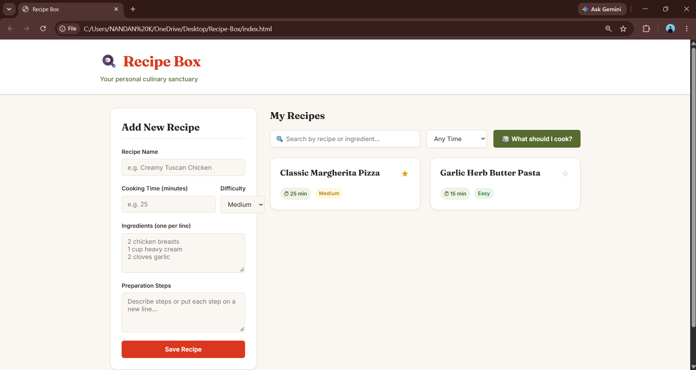
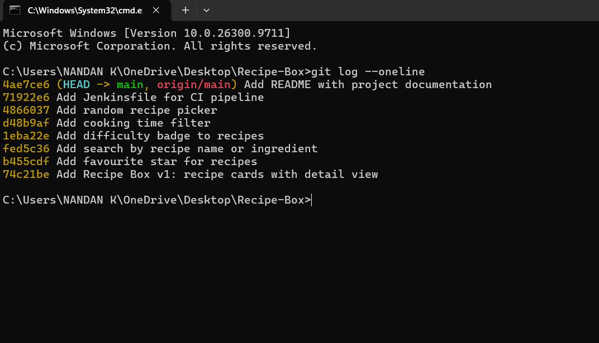
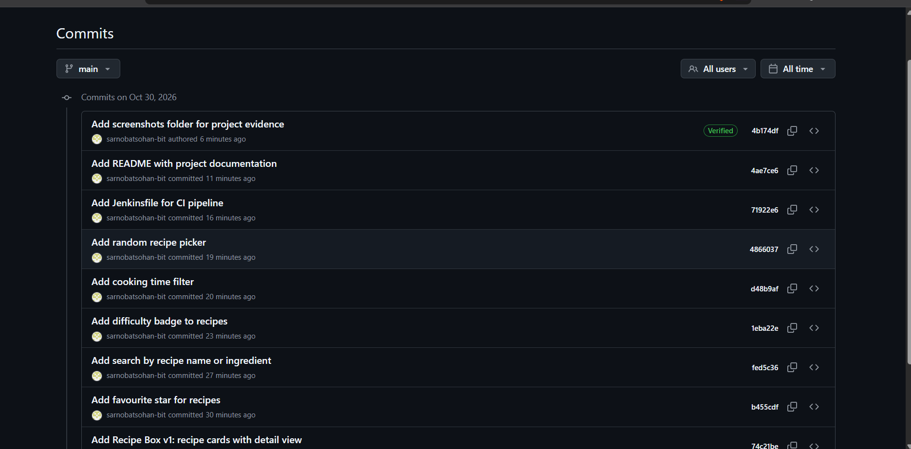
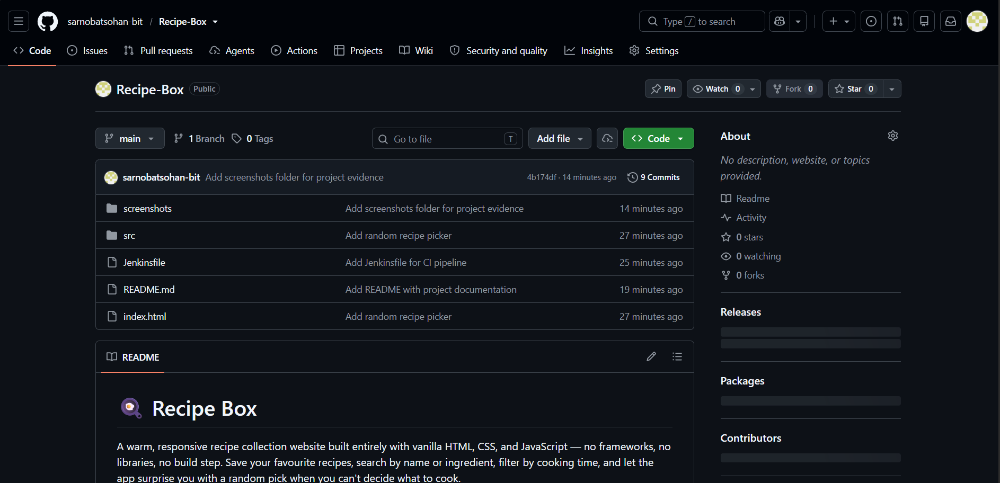
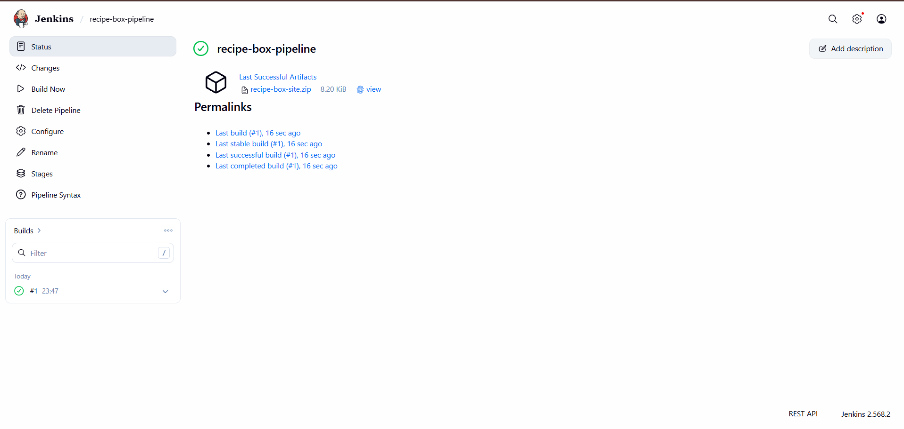

# 🍳 Recipe Box

A warm, responsive recipe collection website built entirely with vanilla HTML, CSS, and JavaScript — no frameworks, no libraries, no build step. Save your favourite recipes, search by name or ingredient, filter by cooking time, and let the app surprise you with a random pick when you can't decide what to cook.

---

## 🎯 Introduction & Objective

**Recipe Box** was built as a hands-on exercise in front-end web development and DevOps workflow integration. The goal was to design a clean, fully functional single-page application from scratch, version-control every incremental feature with Git and GitHub, and wire up a Jenkins CI pipeline — all while keeping the tech stack deliberately simple.

Every piece of state lives in the browser's `localStorage` (wrapped in `try/catch` for safety), and all DOM updates use `textContent` and `createElement` — never `innerHTML`.

---

## 👨‍🎓 Student Information

| Field | Detail |
|---|---|
| **Student Name** | Sohan Sarnobat |
| **Class** | TY CSE (AIML) |
| **Roll No** | 57 |
| **Institution** | D.Y. Patil College of Engineering and Technology, Kolhapur |

---

## 🛠️ Technology Stack

| Layer | Technology |
|---|---|
| **Markup** | HTML5 — semantic elements, accessible ARIA attributes |
| **Styling** | CSS3 — custom properties, CSS Grid, Flexbox, responsive design, Google Fonts (Fraunces + Inter) |
| **Logic** | Vanilla JavaScript (ES6+) — no external libraries or frameworks |
| **Persistence** | Browser `localStorage` with defensive `try/catch` wrappers |
| **Version Control** | Git & GitHub — linear, one-commit-per-feature history |
| **CI/CD** | Jenkins Declarative Pipeline on a Windows agent |

---

## 🚀 How to Run Locally

1. **Clone the repository:**
   ```bash
   git clone https://github.com/sarnobatsohan-bit/Recipe-Box.git
   cd Recipe-Box
   ```

2. **Open in a browser — pick any method:**

   - **Double-click** `index.html` in your file explorer.
   - **VS Code Live Server:** right-click `index.html` → *Open with Live Server*.
   - **Python quick server:**
     ```bash
     python -m http.server 8000
     ```
     Then open `http://localhost:8000` in your browser.

> No `npm install`, no build step — the site is ready as-is.

---

## 📝 Feature Changelog

| # | Commit Message | What Changed |
|---|---|---|
| 1 | `Add Recipe Box v1: recipe cards with detail view` | Core app: add-recipe form, responsive card grid, detail modal with ingredients and numbered steps, delete, localStorage persistence, and two preloaded sample recipes. |
| 2 | `Add favourite star for recipes` | Clickable star toggle on each card that persists to localStorage; favourited recipes float to the top of the list. |
| 3 | `Add search by recipe name or ingredient` | Live search input above the grid that filters cards by recipe name or any ingredient (case-insensitive), with a "No recipes found" empty state. |
| 4 | `Add difficulty badge to recipes` | Difficulty selector (Easy / Medium / Hard) in the add-recipe form; colour-coded badges (green / amber / red) on every card and in the detail modal. |
| 5 | `Add cooking time filter` | Dropdown filter (Any, Under 15 min, Under 30 min) that works together with the search input to narrow results. |

---

## 🔄 Git & GitHub Workflow

Below are the key Git commands used throughout development:

```bash
# Initial setup
git init
git branch -M main
git config user.name "Sohan Sarnobat"
git config user.email "sarnobatsohan@gmail.com"
git remote add origin https://github.com/sarnobatsohan-bit/Recipe-Box.git

# Repeated for each feature
git add -A
git commit -m "<commit message>"
git push origin main
```

**Workflow summary:**
1. Initialised a fresh local repository on the `main` branch.
2. Configured the committer identity (name and email).
3. Added the GitHub remote.
4. For each feature, staged all changes, committed with a clear message, and pushed to `origin/main`.
5. No force-pushes or commit rewrites — the history is linear and clean.

---

## ⚙️ Jenkins CI Integration

### How to set it up

1. **Create a new Jenkins job** → choose **Pipeline**.
2. Under *Pipeline*, select **Pipeline script from SCM**.
3. Set **SCM** to **Git**.
4. **Repository URL:** `https://github.com/sarnobatsohan-bit/Recipe-Box.git`
5. **Branch Specifier:** `*/main`
6. **Script Path:** `Jenkinsfile`
7. Click **Save**, then **Build Now**.

### Pipeline stages

| Stage | What it does |
|---|---|
| **Checkout** | Pulls the latest code from the GitHub repository. |
| **Verify Files** | Confirms `index.html`, `src/styles.css`, and `src/main.js` all exist. |
| **Check JavaScript** | Runs `node --check src/main.js` for syntax validation. If Node.js is not installed on the agent, it prints a message and skips gracefully instead of failing. |
| **Package** | Zips the site into `recipe-box-site.zip` and archives it as a Jenkins artifact. |

A `post` block prints a success or failure message after the pipeline finishes.

---

## 📸 Screenshots

### Website UI


### Git History


### GitHub Commits


### Repository Overview


### Jenkins Pipeline

